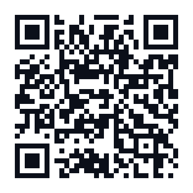

<h1 align="center">☕ Support PLUS98IR · حمایت</h1>

<p align="center">
If my tools helped you, you can buy me a coffee with crypto. Every bit keeps the projects free.<br>
اگه این ابزارها به کارت اومدن، می‌تونی با کریپتو یه قهوه مهمونم کنی. هر مقدار کمک می‌کنه پروژه‌ها رایگان بمونن.
</p>

<p align="center"></p>

<p align="center"><b>USDT (TRC20)</b> · <b>TRX</b> — one address for both / یک آدرس برای هر دو</p>

```
TA53aFyGNfSAcrCaJi9QmA9x5W47nPJcf7
```

> [!WARNING]
> **TRON network only.** Sending from ERC20, BEP20 or any other network will lose the funds.<br>
> **فقط شبکه‌ی TRON.** ارسال از ERC20، BEP20 یا هر شبکه‌ی دیگر باعث از دست رفتن پول می‌شود.

<p align="center">
<a href="https://tronscan.org/#/address/TA53aFyGNfSAcrCaJi9QmA9x5W47nPJcf7">View on Tronscan</a> ·
<a href="https://corenetbase.com/#support">Website</a> ·
<a href="https://corenetbase.com/">All projects / همه پروژه‌ها</a>
</p>

<p align="center">Thank you! ❤ ممنونم!</p>
